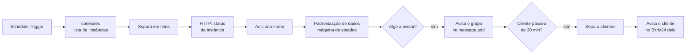

# n8n WhatsApp Watchdog

Workflow n8n que monitora várias instâncias de WhatsApp, avisa a equipe de suporte quando uma conexão cai ou volta e, se a queda passa de 30 minutos, avisa o próprio cliente no Bitrix24 dele com a orientação de reconexão.

Roda em produção monitorando 7 instâncias.

## O problema

Uma instância de WhatsApp desconectada não gera erro visível: as mensagens simplesmente param de chegar no CRM. Um monitor ingênuo, que alerta em toda falha de consulta, gera ruído. A API do provedor oscila (timeout, 5xx, 429), e a equipe passa a ignorar os alertas.

## Como funciona

O núcleo é o nó **Padronização de dados** ([cópia legível em `docs/padronizacao-de-dados.js`](docs/padronizacao-de-dados.js)):

- **Estado entre execuções.** Usa `$getWorkflowStaticData('global')` para guardar o último estado de cada instância, quando a queda começou e quais clientes já foram avisados.
- **Erro de rede ≠ queda.** Timeout, conexão recusada, HTTP 5xx, 429 ou ausência de resposta não alteram o estado da instância.
- **API inteira fora.** Se *todas* as instâncias falham por rede, o problema é o provedor. O grupo recebe um único alerta, e nenhum estado é alterado.
- **Dupla confirmação.** Uma queda só é confirmada depois de 2 rodadas seguidas offline, o que elimina os falsos positivos.
- **Escalonamento.** Depois de 30 minutos offline, o cliente é avisado uma única vez por queda, no Bitrix24 dele.
- **Recuperação.** Quando a instância volta, o grupo é avisado e a mensagem informa desde quando ela estava fora. O mesmo acontece quando a API do provedor volta.

Parâmetros ajustáveis no topo do código: `MINUTOS_LIMITE`, `RODADAS_CONFIRMA` e `TESTE_OFFLINE`. Este último força quedas simuladas para teste.

## Como importar

1. No n8n: **Workflows → Import from file** → `watchdog-instancias-whatsapp.json`.
2. No nó **conexões**, preencha cada instância: nome, URL de status, webhook do Bitrix24 do cliente, destino e mensagem.
3. No nó **HTTP REQUEST API**, ajuste o header de autenticação da API do provedor.
4. No nó **Avisa o Grupo**, troque a URL pelo webhook do seu Bitrix24 e o `DIALOG_ID` pelo chat da equipe.
5. Ative o workflow.

Webhooks que contêm `exemplo.bitrix24` são tratados como "sem configuração" e aparecem no aviso com o marcador `SEM CONFIG`.

## Stack

n8n · JavaScript (nó Code) · API REST do Bitrix24 (`im.message.add`) · API de status de instâncias WhatsApp

## Licença

MIT
